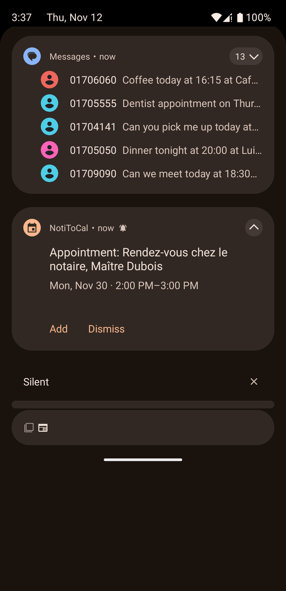
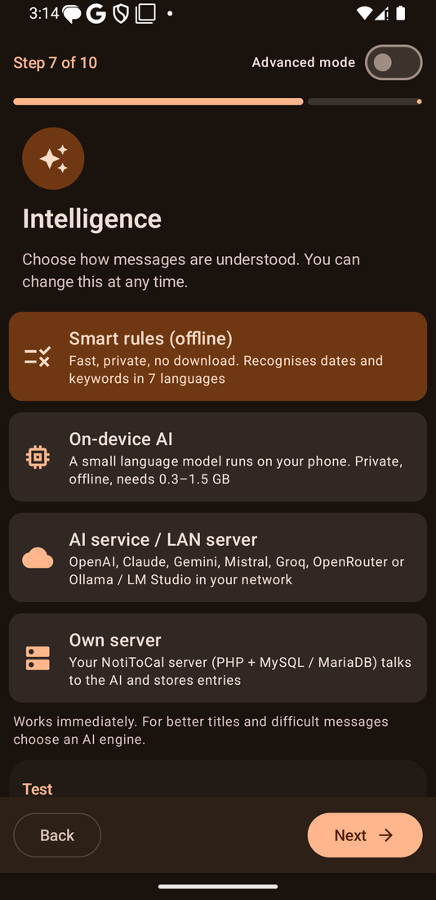

# NotiToCal

**Aus Benachrichtigungen werden Termine und Aufgaben – automatisch.**

NotiToCal liest die Benachrichtigungen der Apps, die du auswählst (WhatsApp, Signal, Telegram, SMS, Gmail, Outlook, Teams …),
erkennt darin Termine und To-dos – mit Offline-Regeln oder einer KI deiner Wahl – und trägt sie in deinen Kalender oder
deine Aufgaben-App ein: automatisch oder nach einem Tipp zur Bestätigung. Screenshots und die Transkripte, die Anti-Vocale
aus Sprachnachrichten macht, funktionieren auch.

Material You · 7 Sprachen (DE, EN, FR, ES, IT, PT, PL) · Datenschutz zuerst · Open Source (MIT)

## Download

- 🌐 **Website: [notitocal.de](https://notitocal.de/)**
- 📱 **[Neueste Version (APK, arm64-v8a)](https://git.juliandigitalproducts.de/jdaniels/NotiToCal/releases/latest)** – der Dateiname enthält die Version, z. B. `NotiToCal-Android-1.0.0.apk`
- Alle Versionen: [Releases](https://git.juliandigitalproducts.de/jdaniels/NotiToCal/releases) · Quellcode: [git.juliandigitalproducts.de/jdaniels/NotiToCal](https://git.juliandigitalproducts.de/jdaniels/NotiToCal)

Android 12 oder neuer, 64-bit ARM (praktisch jedes Handy seit 2019).

## Was NotiToCal kann

- **Quellen:** Benachrichtigungen frei wählbarer Apps, Screenshots (Texterkennung auf dem Gerät oder als Bild an eine Vision-KI), Sprachnachrichten über die Transkripte von Anti-Vocale und beliebiger Text über das Teilen-Menü.
- **Erkennung:** Offline-Regeln für 7 Sprachen, die auch „übermorgen“, „nächsten Freitag“, „halb 4“, Zeiträume und Fristen verstehen – oder eine KI auf dem Gerät, als Dienst, im eigenen Netz oder auf dem eigenen Server.
- **Ziele:** Handy-Kalender (Google, Samsung, Exchange, DAVx⁵ … ohne Login), Tasks.org / OpenTasks, Todoist, CalDAV (Nextcloud, iCloud, mailbox.org …), Notion, eigener Server mit ICS-Kalender-Abo, Webhook (n8n, Home Assistant, Make, Zapier) und Teilen an jede App. Auch Tasker, MacroDroid und Automate können Einträge empfangen – Details in [docs/BUILD.md](docs/BUILD.md).
- **Strenge:** Locker / Ausgewogen / Streng, dazu „automatisch eintragen“ und „auch wenn unsicher“. Wer mehr will, stellt im erweiterten Modus fein ein, z. B. je Typ Automatisch / Fragen / Aus, Ruhezeiten oder Sperrwörter.
- **Bedienung:** Einrichtungsassistent, Bestätigen/Verwerfen direkt in der Benachrichtigung, Verlauf mit Bearbeiten, Material You mit dynamischen Farben, Hell/Dunkel.

## In drei Schritten startklar

1. APK installieren und öffnen – der Assistent führt durch alles.
2. **Benachrichtigungszugriff** erlauben. Meldet Android „eingeschränkte Einstellung“: *App-Info › ⋮ › Eingeschränkte Einstellungen zulassen*.
3. Apps, KI-Engine, Ziele und Strenge wählen – fertig.

## KI-Engines

- **Intelligente Regeln** – sofort, offline, keine Daten verlassen das Handy.
- **KI auf dem Gerät** – unter *Einstellungen › KI-Engine › Modelle verwalten* ein Modell laden oder eine `.task`-Datei importieren. Empfohlen: **Qwen 2.5 1.5B** (1,5 GB, ab 4 GB RAM); weitere Modelle wie Gemma, Phi oder DeepSeek sind wählbar. Gemma braucht ein Hugging-Face-Token mit akzeptierter Lizenz.
- **KI-Dienst** – OpenAI, Claude, Gemini, xAI Grok, Mistral, Groq, OpenRouter, DeepSeek. Der API-Schlüssel liegt verschlüsselt im Android Keystore.
- **KI im eigenen Netz** – Ollama, LM Studio, oMLX, llama.cpp, LocalAI, vLLM, z. B. `http://192.168.1.10:11434/v1`. Unverschlüsseltes `http://` geht nur im eigenen Netz, alles andere braucht HTTPS.
- **Eigener Server** – PHP + MySQL/MariaDB, hält den KI-Schlüssel und liefert einen ICS-Feed. Einrichtung: [server/README.md](server/README.md).

Ein Vorfilter schickt nur Nachrichten an die KI, die nach Termin oder Aufgabe aussehen – das spart Akku und Kosten. Fällt die KI aus, übernehmen die Regeln.

## Im Alltag

**Akku:** Benachrichtigungen kommen sofort an, ausgewertet wird gesammelt – standardmäßig 3× täglich um 8, 13 und 18 Uhr,
wählbar bis „sofort“. Dringendes („in 20 Minuten“) wird sofort ausgewertet; optional nur im WLAN oder nur beim Laden.

**Kalender-Regeln:** Nach Absender, Stichwort oder KI-Kategorie landet ein Eintrag im passenden Kalender, in der
passenden Aufgabenliste, im Todoist-Projekt, CalDAV- oder Notion-Ziel.

**KI-Routinen:** Das Ziel *KI-Routine* gibt jeden Eintrag samt Originalnachricht an einen KI-Anbieter deiner Wahl
(Claude, Grok, ChatGPT, Gemini, lokale Modelle), der deine Routine ausführt – etwa eine Agenda vorbereiten oder eine
Antwort entwerfen. Die Antwort kommt als Benachrichtigung zum Teilen.

**Sprachnachrichten:** Die Transkription übernimmt die App **Anti-Vocale**; NotiToCal importiert deren Texte aus dem
Export-Ordner automatisch und sucht darin nach Terminen und Aufgaben.

**Termine aus Adressen** (optional, Standard aus): Enthält eine Nachricht nur eine vollständige Adresse und kein Datum,
schlägt NotiToCal leise einen Termin für heute vor – nie ein automatischer Eintrag.

## Datenschutz

Kein Konto, keine eigene Analyse, keine Werbung, keine eigene Cloud. Mit Regeln oder KI auf dem Gerät verlassen
Nachrichten das Handy nicht. Ausnahme: Google ML Kit, das Text in Bildern auf dem Handy erkennt, sendet laut Google
anonyme Nutzungs- und Leistungsstatistiken an Google (keine Bilder, keine Texte). Die optionale Adresssuche fragt
Photon, Nominatim und Overpass (nur Ortsangaben und eine auf etwa 1 km gerundete Position). Absendernamen gehen nur auf
Wunsch an die KI, Originaltexte nur auf Wunsch an Webhooks und den eigenen Server. Schlüssel werden mit einem
Android-Keystore-Schlüssel verschlüsselt, Android-Backups sind ausgeschlossen. Details: [docs/privacy-policy.md](docs/privacy-policy.md).

Bauen, Tests, CI und Signatur: [docs/BUILD.md](docs/BUILD.md).

---

## English

**Turn notifications into actions automatically.** NotiToCal reads the notifications of the apps you choose (WhatsApp,
Signal, Telegram, SMS, Gmail, Outlook, Teams …), recognises appointments and to-dos with offline rules or an AI of your
choice and puts them into your calendar or task app — automatically or after a one-tap confirmation. Screenshots and the
transcripts Anti-Vocale makes of voice messages work too.

**Privacy:** No account, no analytics of our own, no ads, no own cloud. With the rules or the on-device AI, messages stay
on the phone. Exception: Google ML Kit, which reads text in pictures on the phone, sends usage and performance statistics
to Google according to Google (no pictures, no texts). The optional address lookup asks Photon, Nominatim and Overpass
(place details and a position rounded to about 1 km only). Full details: [docs/privacy-policy.md](docs/privacy-policy.md).

**Download:** [notitocal.de](https://notitocal.de/) · [latest release (APK, arm64-v8a)](https://git.juliandigitalproducts.de/jdaniels/NotiToCal/releases/latest) ·
[all releases](https://git.juliandigitalproducts.de/jdaniels/NotiToCal/releases) ·
[source code](https://git.juliandigitalproducts.de/jdaniels/NotiToCal). Android 12 or newer, 64-bit ARM.

## Lizenz / License

[MIT](LICENSE) © 2026 juliandigitalproducts. On-device models are downloaded from Hugging Face under their own licences
(Qwen: Apache 2.0, Gemma: Gemma Terms of Use). ML Kit text recognition and MediaPipe are © Google. The app lists all
bundled libraries with their full license texts under *Settings › Privacy and about › Licenses of all components*.

All product names and trademarks mentioned (WhatsApp, Telegram, Signal, Google, OpenAI, Anthropic and others) belong to
their owners; NotiToCal is not affiliated with or endorsed by them.

## Kontakt / Contact

Provider / imprint: [juliandigitalproducts.de/impressum](https://juliandigitalproducts.de/impressum) ·
Privacy policy: [docs/privacy-policy.md](docs/privacy-policy.md)
