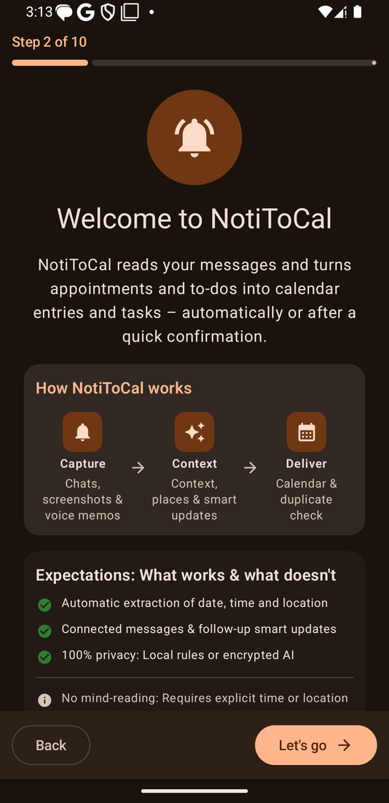
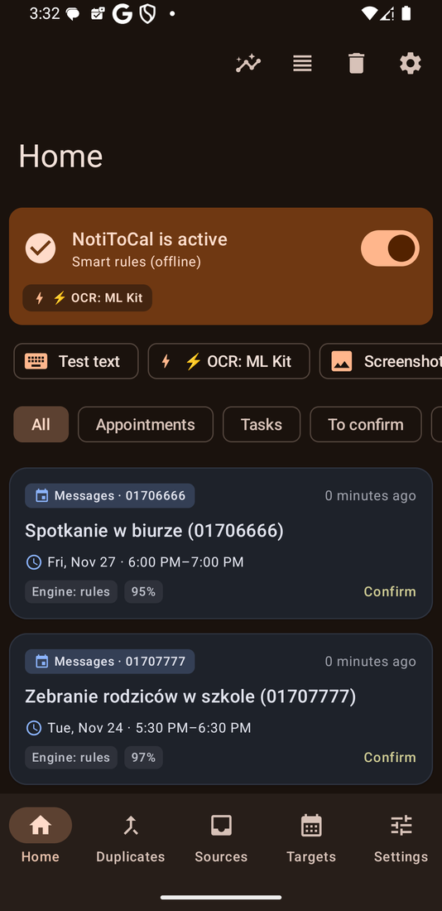
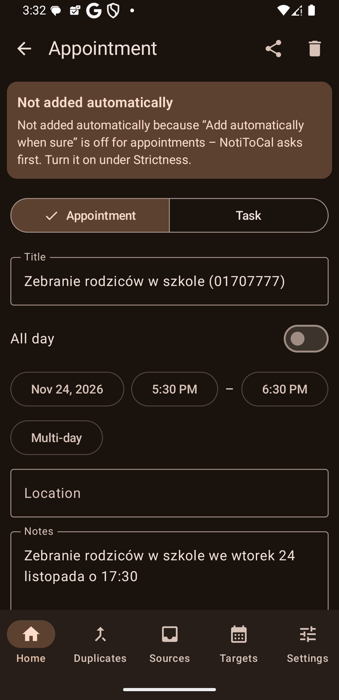

# NotiToCal

**Turn notifications into actions automatically.**
NotiToCal reads the notifications of the apps you choose (WhatsApp, Signal, Telegram, SMS, Gmail, Outlook, Teams …),
recognises appointments and to-dos with offline rules or an AI of your choice and puts them into your calendar or task
app — automatically or after a one-tap confirmation. Screenshots and the transcripts Anti-Vocale makes of voice messages work too.

Material You · 7 languages (DE, EN, FR, ES, IT, PT, PL) · privacy first · open source (MIT)

<p>





</p>

## Download

- 🌐 **Website: [notitocal.com](https://notitocal.com/)**
- 📱 **[Latest release (APK, arm64-v8a)](https://git.juliandigitalproducts.de/jdaniels/NotiToCal/releases/latest)**: file names carry the version, e.g. `NotiToCal-Android-1.0.0.apk`
- All versions: [Releases](https://git.juliandigitalproducts.de/jdaniels/NotiToCal/releases)
- Source code: [git.juliandigitalproducts.de/jdaniels/NotiToCal](https://git.juliandigitalproducts.de/jdaniels/NotiToCal) · GitHub (soon)

Android 12 or newer, 64-bit ARM (practically every phone since 2019).


---

## Deutsch

### Was NotiToCal kann

| Bereich | Funktionen |
|---|---|
| **Quellen** | Benachrichtigungen frei wählbarer Apps · Screenshots (Texterkennung auf dem Gerät oder als Bild an eine Vision-KI; Bild und mitgeteilter Text zählen als eine Nachricht) · Sprachnachrichten über die Transkripte von Anti-Vocale · beliebiger Text über das Teilen-Menü |
| **Erkennung** | Intelligente Offline-Regeln für 7 Sprachen (relative Daten wie „übermorgen“, „nächsten Freitag“, „halb 4“, „15h30“, Zeiträume, Fristen) · KI auf dem Gerät (MediaPipe, Qwen 2.5 / Gemma 3) · KI-Dienste (OpenAI, Claude, Gemini, xAI Grok, Mistral, Groq, OpenRouter, DeepSeek) · KI im eigenen Netz (Ollama, LM Studio, oMLX, llama.cpp, LocalAI, vLLM; auch „denkende“ Modelle wie Qwen 3 und Gemma 4) · eigener Server (PHP + MySQL/MariaDB) |
| **Ziele** | Handy-Kalender (Google, Samsung, Exchange, DAVx⁵ … ohne Login) · Kalender-App (vorausgefüllt) · Tasks.org / OpenTasks · Todoist · CalDAV (Nextcloud, iCloud, mailbox.org, Radicale …) · Notion · eigener Server (inkl. ICS-Kalender-Abo) · Webhook (n8n, Home Assistant, Make, Zapier) · Tasker/MacroDroid-Broadcast · Teilen an jede App (Samsung Notes, Google Notizen, Microsoft To Do, TickTick …) |
| **Strenge** | Einfacher Modus: Locker / Ausgewogen / Streng + „automatisch eintragen“ + „auch wenn unsicher“. Erweiterter Modus: Mindestsicherheit je Typ, Schwelle für automatisches Eintragen, Modus je Typ (Automatisch / Fragen / Aus), Uhrzeit-Pflicht, Termine ohne Datum als Aufgabe, Vergangenheit ignorieren, max. Tage voraus, Mindestlänge, Duplikatfenster, Ruhezeiten, Stichwort-Boost, Sperrwörter, ignorierte Absender, Gruppenchats, Vorfilter, KI-Temperatur, Tokens, Timeout, eigene KI-Anweisungen … |
| **Bedienung** | Einrichtungsassistent · Bestätigen/Verwerfen direkt in der Benachrichtigung · Verlauf mit Bearbeiten · Material You (dynamische Farben, Themed Icon) · Hell/Dunkel |

### Einrichtung
1. APK installieren und öffnen — der Assistent führt durch alles.
2. **Benachrichtigungszugriff** erlauben. Meldet Android „eingeschränkte Einstellung“: *App-Info › ⋮ › Eingeschränkte Einstellungen zulassen*.
3. Apps wählen, KI-Engine wählen, Ziele wählen, Strenge einstellen — fertig.

### KI-Engines
- **Intelligente Regeln** – sofort, offline, keine Daten verlassen das Handy.
- **KI auf dem Gerät** – *Einstellungen › KI-Engine › Modelle verwalten*: Modell laden (nach dem Download automatisch ausgewählt, „Weiter“ führt zurück) oder eine `.task`-Datei importieren. Gemma braucht ein Hugging-Face-Token mit akzeptierter Lizenz.

  | Modell | Größe | Tempo | Qualität | RAM ab |
  |---|---|---|---|---|
  | Qwen 2.5 1.5B (empfohlen) | 1,5 GB | ●●●○○ | ●●●●○ | 4 GB |
  | Qwen 2.5 0.5B | 0,5 GB | ●●●●● | ●●○○○ | 3 GB |
  | Gemma 3 1B q4 / q8 | 0,5 / 1 GB | ●●●●○ / ●●●○○ | ●●●○○ | 3–4 GB |
  | Gemma 3n E2B | 3 GB | ●●○○○ | ●●●●○ | 6 GB |
  | Gemma 3n E4B | 4,2 GB | ●○○○○ | ●●●●● | 8 GB |
  | Phi-4 mini 3.8B | 3,8 GB | ●○○○○ | ●●●●○ | 8 GB |
  | DeepSeek R1 Distill 1.5B (denkt nach) | 1,8 GB | ●○○○○ | ●●●○○ | 4 GB |
  | Gemma 3 270M / SmolLM 135M (nur Test) | 0,3 / 0,16 GB | ●●●●● | ●○○○○ | 2 GB |
- **KI-Dienst / LAN-Server** – Anbieter wählen, API-Schlüssel eintragen (verschlüsselt im Android Keystore). Für Ollama z. B. `http://192.168.1.10:11434/v1`. Unverschlüsseltes `http://` geht nur für Adressen im eigenen Netz, alles andere braucht HTTPS. Bei Ollama schaltet NotiToCal das Nachdenken „denkender“ Modelle (Qwen 3, Gemma 4) ab.
- **Eigener Server** – siehe [server/README.md](server/README.md). Der Server hält den KI-Schlüssel, speichert alles in MySQL/MariaDB und liefert einen ICS-Feed.
- **Vorfilter**: Nur Nachrichten, die nach Termin/Aufgabe aussehen, gehen an die KI (spart Akku und Kosten). Fällt die KI aus, übernehmen die Regeln.

### Akku & Auswertung
*Einstellungen › Akku & Auswertung*: Benachrichtigungen kommen sofort an und werden lokal zwischengespeichert; ausgewertet
wird gesammelt (Standard 3× täglich um 8, 13 und 18 Uhr; wählbar: sofort, 15 min, stündlich, 3 h, feste Uhrzeiten, einmal
täglich). Dringende Nachrichten (heute, nächste Stunden, „in 20 Minuten“) werden sofort ausgewertet. Optional nur im WLAN
oder nur beim Laden. Benachrichtigungen lassen sich einzeln filtern (eingetragen, Bestätigung, Sprachnachrichten-Text, Fehler).
Seltene Auswertung spart Akku, kann aber kurzfristige Termine zu spät erkennen.

### Kalender nach Absender und Thema
*Einstellungen › Kalender und Aufgaben › Kalender-Regeln*: Jede Regel hat Absender, Stichwörter und eine Beschreibung für
die KI. Passt eine Regel, landet der Eintrag in ihrem Kalender / ihrer Aufgabenliste / ihrem Todoist-Projekt, CalDAV- oder
Notion-Ziel und kann zusätzliche Ziele bekommen. Reihenfolge: Absender › Stichwort › KI-Kategorie. Im Eintrag lässt sich
die Regel nachträglich ändern.

### KI-Routinen (Claude, Grok, ChatGPT, Gemini, lokale Modelle)
Ziel **KI-Routine** gibt jeden Eintrag samt Originalnachricht an einen KI-Anbieter deiner Wahl, der deine Routine
ausführt (z. B. Agenda vorbereiten, Antwort entwerfen, Route planen). Die Antwort kommt als Benachrichtigung zum Teilen.
Jede Kalender-Regel kann eine eigene Routine haben. Für Bots, Routine-Trigger oder Chat-Webhooks (Slack, Discord,
Telegram …) kann der Webhook-Inhalt im erweiterten Modus als Vorlage mit Platzhaltern (`{{title}}`, `{{when}}`,
`{{json}}` …) gestaltet werden.

### Sprachnachrichten (mit Anti-Vocale)
Die Transkription übernimmt die App **Anti-Vocale**; NotiToCal wertet nur deren Texte aus. *Quellen › Anti-Vocale*:
Export-Ordner von Anti-Vocale wählen und „Automatisch importieren“ einschalten. Neue Transkripte werden bei jeder
Sprachnachricht-Benachrichtigung und zusätzlich im eingestellten Abstand (15 min bis 6 h, oder nur bei Benachrichtigung)
geprüft, auf Termine/Aufgaben untersucht und auf Wunsch als Benachrichtigung gezeigt. „Jetzt prüfen“ holt sie sofort.

### Termine aus Adressen (optional)
*Strenge › Termine aus Adressen vorschlagen* (Standard: aus). Enthält eine Nachricht nur eine vollständige Adresse
(Straße, Hausnummer und Ort) und kein Datum, wird daraus ein leiser Vorschlag für heute — nie ein automatischer Eintrag.
Ein Ortsname allein („im Büro“, „bei Aldi“) reicht nicht.

### Automatisierung
Ziel „Tasker / Automatisierung“ sendet den Broadcast `de.juliandigitalproducts.notitocal.DETECTED` mit den Extras
`kind, title, description, start, end, all_day, due, location, priority, confidence, source_app, source_package, sender, start_millis`.
Empfänger sind Tasker, MacroDroid und Automate oder die eine App, die du unter „Senden an“ wählst — nicht mehr jede installierte App.

### Datenschutz
Kein Konto, keine eigene Analyse, keine Werbung, keine eigene Cloud. Mit Regeln oder KI auf dem Gerät verlassen
Nachrichten das Handy nicht. Ausnahme: Google ML Kit, das Text in Bildern auf dem Handy erkennt, sendet laut Google
anonyme Nutzungs- und Leistungsstatistiken an Google (keine Bilder, keine Texte). Die optionale Adresssuche fragt
Photon, Nominatim und Overpass (nur Ortsangaben und eine auf etwa 1 km gerundete Position). Der optionale Standortverlauf
bleibt auf dem Gerät. Absendernamen
gehen nur auf Wunsch an die KI, Originaltexte nur auf Wunsch an Webhooks und den eigenen Server. Schlüssel werden mit
einem Android-Keystore-Schlüssel verschlüsselt, Android-Backups sind ausgeschlossen; ein selbst exportiertes Backup
enthält Schlüssel nur auf Wunsch und dann mit Passwort verschlüsselt. Details: [docs/privacy-policy.md](docs/privacy-policy.md).

---

## English

### Privacy
No account, no analytics of our own, no ads, no own cloud. With the rules or the on-device AI, messages stay on the phone.
Exception: Google ML Kit, which reads text in pictures on the phone, sends usage and performance statistics to Google
according to Google (no pictures, no texts). The optional address lookup asks Photon, Nominatim and Overpass (place
details and a position rounded to about 1 km only). The optional location history stays on the device. Full details:
[docs/privacy-policy.md](docs/privacy-policy.md).

### Features
- **Sources:** notifications of the apps you pick, screenshots (on-device OCR or vision AI; image and shared text count as one message), voice messages via Anti-Vocale transcripts, any shared text.
- **Engines:** offline rules for 7 languages, on-device LLM (MediaPipe: Qwen 2.5, Gemma 3), cloud AI (OpenAI, Anthropic Claude, Google Gemini, xAI Grok, Mistral, Groq, OpenRouter, DeepSeek), LAN AI (Ollama, LM Studio, oMLX, llama.cpp, LocalAI, vLLM, including thinking models such as Qwen 3 and Gemma 4) and your own server (PHP + MySQL/MariaDB).
- **Targets:** phone calendar (any synced account, no login), calendar app (pre-filled), Tasks.org / OpenTasks, Todoist, CalDAV, Notion, own server with ICS subscription, webhooks, Tasker broadcast, share to any app (Samsung Notes, Keep, Microsoft To Do, TickTick …).
- **Strictness:** simple presets (Relaxed / Balanced / Strict) or an advanced mode exposing every parameter.
- **UX:** setup assistant, confirm/dismiss from the notification, editable history, Material You with dynamic colours and themed icon.

### Build
```bash
./gradlew :app:testDebugUnitTest :app:lintRelease :app:assembleRelease
```
Strings live in `tools/i18n/*.py`; regenerate the resources with `python3 tools/i18n/generate.py`.

A release build needs the release key: `NOTITOCAL_KEYSTORE_FILE`, `NOTITOCAL_KEYSTORE_PASSWORD`, `NOTITOCAL_KEY_ALIAS`,
`NOTITOCAL_KEY_PASSWORD` or `../notitocal-release.keystore.properties`. Without it the build stops; for a local test
build with the public preview key in `signing/` add `-PnotitocalPreview` (such APKs are never published).

CI runs on the project's own Forgejo instance: branches build a debug
test APK; on `main` the patch version in `version.properties` is bumped and the APK is signed with the release key,
tagged and released. `versionCode` comes from `version.properties` for local and CI builds. `.github/smoke.sh` is an emulator smoke
test that can be run by hand.

### Tests
| What | Command |
|---|---|
| Unit tests (Robolectric, no device) | `./gradlew :app:testDebugUnitTest` |
| Pipeline harness: the sample messages (`MessageSamples`) through the whole local pipeline – filters, pre-filter, model call, rules, decision, duplicate check, CalDAV / own server / webhook writers – with fake targets on 127.0.0.1 and a fixed clock (Fri 20.11.2026 10:00 Europe/Berlin); also checks that no message text leaves with "Send message text to webhook and server" off | `./gradlew :app:pipelineHarness` → `app/build/reports/pipeline-harness.md`, `app/build/reports/prefilter-30-samples.md` |
| E2E on an emulator/device: notifications posted with `cmd notification post` reach the listener and show up as a suggestion (UI Automator) | `./gradlew :app:connectedDebugAndroidTest` (only compile: `:app:assembleDebugAndroidTest`) |
| Server E2E: `api.php` in PHP's built-in server with SQLite – store, update by uid, validation, ICS feed | `php server/tests/e2e.php` |

The E2E test changes the app's settings on the device (offline rules, `com.android.shell` in the app list) and Gradle
uninstalls the app after the run, so use a test emulator.

### Project layout
```
app/src/main/java/de/juliandigitalproducts/notitocal/
  analysis/   DateParser, RuleEngine, LLM clients, on-device model manager, strictness decision
  capture/    NotificationListenerService, screenshots, Anti-Vocale transcripts, share target
  output/     calendar, task apps, Todoist, CalDAV, Notion, server, webhook, broadcast, share
  pipeline/   filter → analyse → decide → log → deliver / ask
  ui/         Compose screens (wizard, home, entry, settings, models)
server/       self-hosted PHP bridge for MySQL / MariaDB (+ docker-compose), tests/ = server E2E (not for upload)
tools/i18n/   translations (7 languages) and generator
```

## License
[MIT](LICENSE) © 2026 juliandigitalproducts. On-device models are downloaded from Hugging Face under their own licences
(Qwen: Apache 2.0, Gemma: Gemma Terms of Use). ML Kit text recognition and MediaPipe are © Google. The app lists all
bundled libraries with their full license texts under *Settings › Privacy and about › Licenses of all components*.

All product names and trademarks mentioned (WhatsApp, Telegram, Signal, Google, OpenAI, Anthropic and others) belong to
their owners; NotiToCal is not affiliated with or endorsed by them.

Provider / imprint: [juliandigitalproducts.de/impressum](https://juliandigitalproducts.de/impressum) ·
Privacy policy: [docs/privacy-policy.md](docs/privacy-policy.md)
